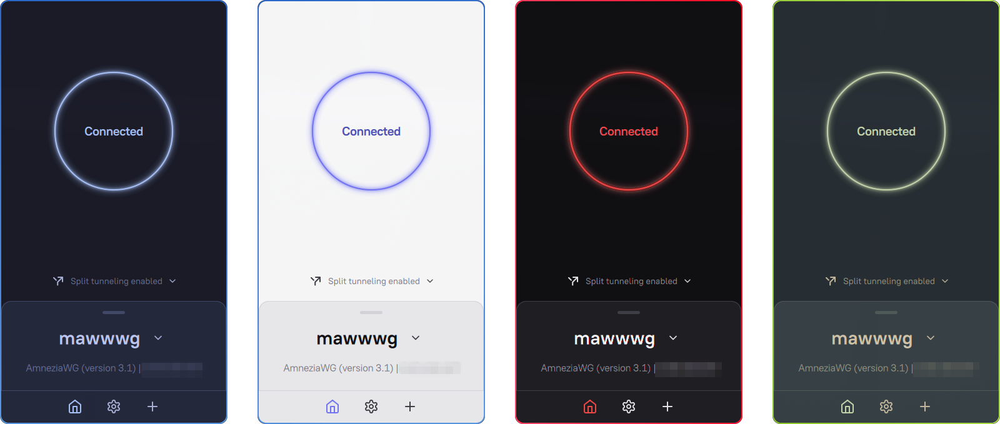
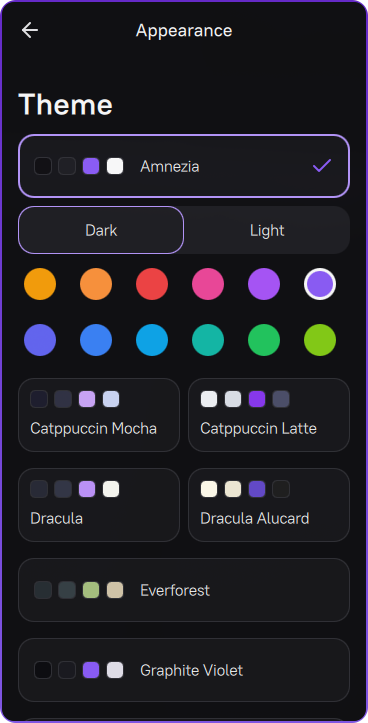

# AmneziaVPN Linux QoL

Fork of [amnezia-vpn/amnezia-client](https://github.com/amnezia-vpn/amnezia-client)
with Linux quality-of-life changes: **themes** with an accent picker and a light
scheme, a **native CLI** inside the same GUI binary, and **a fix for site split**
**tunneling** that silently stopped installing routes.

<p align="center">
  
</p>

> Upstream readme and docs: [amnezia-vpn/amnezia-client](https://github.com/amnezia-vpn/amnezia-client#readme),
> [docs.amnezia.org](https://docs.amnezia.org).

**Linux only.** Built, packaged and tested on Arch. The CLI is not built or
packaged for macOS and Windows here, and `deploy/build_cli_package.sh` is
Linux-only.

## What is in here

### Themes

11 palettes, 12 accent colours and a light mode. Switching is
instant, survives a restart and recolours the whole interface.

<p align="left">
  
</p>


**Amnezia (default)** keeps the original look and adds two knobs:

- **Dark / Light** scheme
- **12 accents** — amber, orange, red, pink, purple, violet, indigo, blue, sky,
  teal, green, lime

**Presets**:

- Catppuccin Latte (light) / Mocha (dark)
- Rosé Pine Moon (dark) / Dawn (light)
- Dracula (dark) / Alucard (light)
- Graphite Violet
- Tokyo Night
- Everforest
- Kanagawa
- Nord

Adding a theme means one entry with 14 colours in
`client/core/theme/themePalettes.cpp`.

### Native CLI

`status`, `servers`, `connect`, `disconnect`, `watch` — plus `--json` and
`--redact`. Built for scripted control: status bars, widgets, hotkeys,
automation.

```bash
AmneziaVPN status [--json] [--redact]      # what is connected right now
AmneziaVPN servers [--json]                # configured servers, GUI order
AmneziaVPN connect [index] [--json]        # default server, or the Nth
AmneziaVPN disconnect [--json]             # idempotent
AmneziaVPN watch [--json] [--redact]       # one JSON line per state change
```

`status`:

```
connected: yes
  device:  10.13.13.2
  gateway: 203.0.113.7
  rx/tx:   12450816 / 1048576 bytes
  since:   Mon Nov 10 09:14:22 2026
```

The CLI process sends one line-delimited JSON request to the running GUI over
`QLocalSocket` (`AmneziaVPNInstance`) and exits: 0 ok, 1 failure, 2 usage.
`connect` and `disconnect` confirm *acceptance*, not the result — connect is
asynchronous, so poll `status` or keep `watch` open. `--redact` masks IPs
(`1.2.3.4` → `1.2.*.*`). With no GUI running, `status` falls back to the
privileged daemon, so a tunnel that outlived the window still shows up —
without server name and protocol, which the daemon does not know.

### Split tunneling fix

Upstream reads the kernel route table through a fixed 8 KiB netlink buffer
(`NetworkUtilities::getGatewayAndIface`). Once the table passes roughly a
hundred entries — which the exclusion routes of a large site list create by
themselves — the dump does not fit. The lookup then returns an empty gateway
and every exclusion route is skipped with `No default gateway available`;
routes already installed are never removed either, because the delete path
uses the same lookup.

The fix grows the buffer, treats a full buffer as the end of the dump, caches
the gateway for the session, skips empty endpoints, and deletes per-prefix
routes instead of inserting them.

## Branches

| branch | purpose |
| --- | --- |
| `main` | mirrors `upstream/dev`; no local commits |
| `qol` | integration branch: `main` plus every feature below |
| `feat/cli` | native CLI |
| `feat/theme` | themes, accents, light scheme |
| `fix/linux-exclusion-routes` | split tunneling fix |

`qol` is `main` plus the feature branches. Features stay independent so each
can be rebased onto a new upstream on its own and, where it is a bug fix,
offered upstream as a pull request.

## Building

Requirements: Qt 6.10.1 from aqtinstall with `qtremoteobjects qt5compat
qtshadertools qthttpserver qtwebsockets`, Qt Installer Framework, Conan 2.34,
CMake 3.25+, Ninja, GCC.

```bash
git clone --recursive https://github.com/mceblvn/amnezia-client-linux-qol.git
cd amnezia-client-linux-qol
cp deploy/.cli-env.example deploy/.cli-env     # fill in the gateway keys
deploy/build_cli_package.sh --generator Ninja
```

→ `deploy/build/AmneziaVPN_5.1.0.6_linux_x64.run`. Add `--suffix +qol.1` to
tag the package name.

The script is a thin wrapper over `deploy/build.sh --installer all`: it
sources `deploy/.cli-env`, refuses to build with empty keys, and verifies the
keys ended up in the binary. `deploy/build.sh` finds Qt and QtIFW in the
aqtinstall layout (`~/Qt`, or `QT_INSTALL_DIR`/`QT_ROOT_PATH`/`QIF_ROOT_PATH`).

Use the aqt Qt, not the distro one: Qt's deploy on a distro Qt copies an
incomplete plugin set, drags `libc` and `libstdc++` into the bundle, and dies
on RPATH.

## Syncing with upstream

```bash
git fetch upstream
git rebase upstream/dev feat/cli
git rebase upstream/dev feat/theme
git rebase upstream/dev fix/linux-exclusion-routes
git checkout -B qol feat/cli
git cherry-pick main..fix/linux-exclusion-routes
git cherry-pick main..feat/theme
```

## Premium keys

`deploy/.cli-env` (gitignored) holds the gateway keys and mirror endpoints.
Without them everything works except Premium API calls. Key format is strict:
one line, literal `\n`, no trailing newline — the PEM bytes are hashed into
the AES key for proxy payloads, one extra byte breaks the whole path.

## Install layout

```
/opt/AmneziaVPN/bin/AmneziaVPN            # client + CLI
/opt/AmneziaVPN/bin/AmneziaVPN-service    # privileged service
/opt/AmneziaVPN/{lib,plugins,qml}         # bundled Qt
~/.config/AmneziaVPN.ORG/AmneziaVPN.conf  # config, kept across installs
```

## License

GNU General Public License v3.0 (see LICENSE). This fork is not affiliated
with or endorsed by the Amnezia project.
